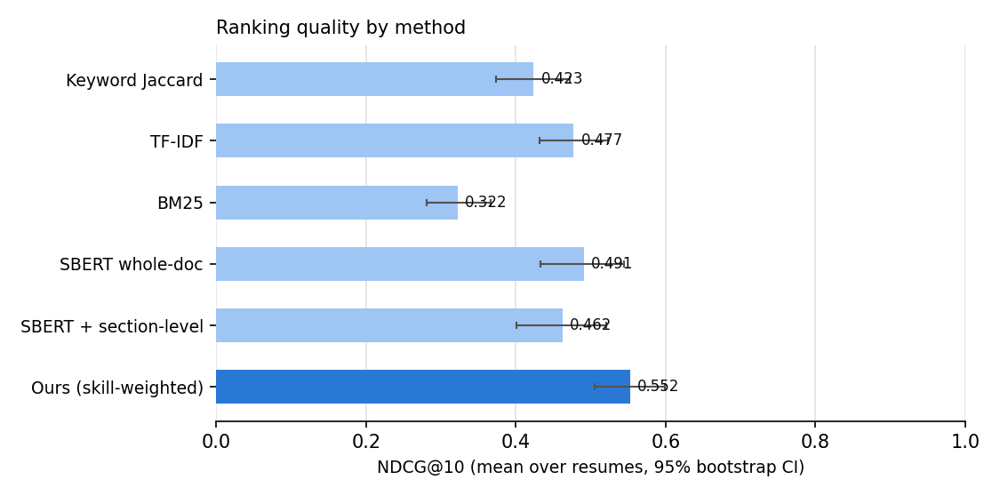
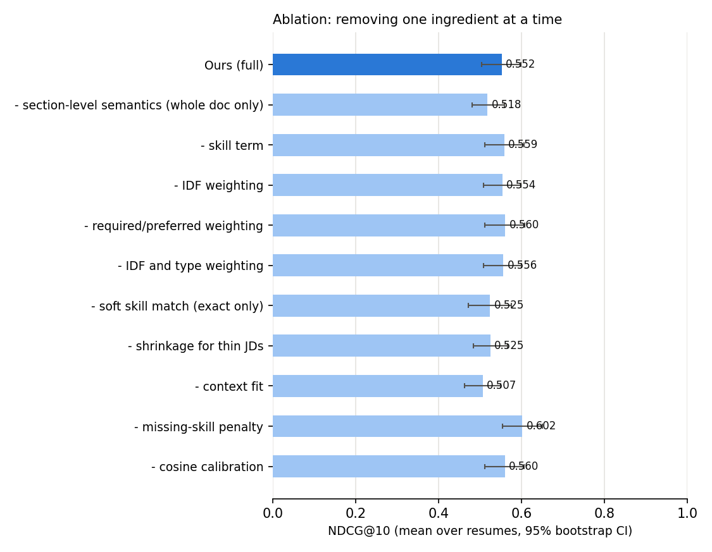
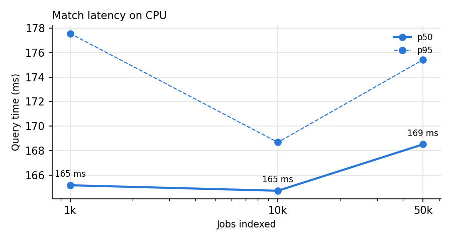

# SkillMatch: Semantic Resume-Job Matching with Skill-Weighted Sentence Embeddings

_Mini project report. Generated by `eval/build_report.py` from the results in `eval/results/`; re-run the
evaluation scripts and this file updates with them._

## Abstract

Keyword matching misses related skills ("ML model development" vs "machine learning algorithms"), while a single
whole-document embedding treats every word of a resume as equally important. SkillMatch combines section-level
sentence embeddings with an explicit, weighted skill layer: each job-description (JD) skill is weighted by whether it
is required or preferred and by how rare it is across the job corpus, and resume skills are matched to it softly
through calibrated embedding similarity. A context term (experience, job type, location, education) and a penalty
for missing required skills complete the score. The system is wrapped in a candidate-facing product that ingests
jobs only from official sources, explains every score, shows the skill gap, hands the user off to the exact
application page, and adds a campus placement mode for training-and-placement officers (TPOs).
We rank a pool of 200 real job postings for each of 40 resumes. Our skill-weighted model reaches NDCG@10 0.552, ahead of the best baseline (SBERT whole-doc, 0.491; +0.062). After Holm correction it is significantly better than Keyword Jaccard, TF-IDF, BM25, SBERT + section-level, but not significantly better than SBERT whole-doc.

## 1. Problem

Candidates search many job boards, read long descriptions and guess at fit; keyword filters reward exact wording
rather than ability. Placement offices face the mirror problem: shortlisting hundreds of students per drive by hand.
The project asks whether weighting skills by their importance to a job, on top of sentence embeddings, ranks jobs
(and candidates) better than lexical retrieval or plain embeddings, while keeping every score explainable.

## 2. Related work

- **Lexical retrieval.** TF-IDF and Okapi BM25 (Robertson and Zaragoza, 2009) remain strong text-matching baselines
  but cannot relate different wordings of the same skill.
- **Sentence embeddings.** Sentence-BERT (Reimers and Gurevych, 2019) made bi-encoder similarity practical; the BGE
  family (Xiao et al., 2023) is a strong small English encoder, used here (`BAAI/bge-small-en-v1.5`).
  Contrastive fine-tuning with in-batch negatives (Henderson et al., 2017) adapts an encoder to a domain.
- **Person-job fit.** Neural person-job fit models (e.g. Zhu et al., 2018; Qin et al., 2018) learn joint
  representations of resumes and JDs from large proprietary hiring data. This project targets the opposite regime:
  no historical hiring data, a transparent score and explicit skill weights a placement officer can edit.
- **Skill taxonomies.** ESCO, the European multilingual skills classification, supplies standard skill concepts;
  SkillMatch combines 749 curated technology skills (with aliases) and 695 ESCO technical skills.
- **Evaluation.** Ranking quality uses P@K, recall, MRR and NDCG (Jarvelin and Kekalainen, 2002) with paired
  Wilcoxon tests and Holm (1979) correction.

## 3. System overview

```
PDF resume -> text (two-column aware) -> sections -> PII masking (bias-aware mode)
           -> skills (phrase matcher over taxonomy + embedding normalisation) -> profile
Official job APIs (Greenhouse, Lever, Ashby, Remotive, Adzuna, Jooble, JSearch*, SerpApi*)
           -> normalise -> JD skills + required/preferred weights -> dedup -> FAISS index
Match: FAISS top-300 by resume embedding -> filters -> skill-weighted re-scoring -> explanation, skill gap
Campus: bulk import -> drives -> eligibility (with reasons) -> ranked, blind shortlist -> rounds -> offers -> analytics
```
`*` keyed sources; see Limitations. The architecture diagram is in `docs/architecture.md`.

## 4. Method

**Score.** For candidate c and job j:

S = alpha * Sem + beta * Skill + gamma * Context - delta * Penalty, clipped to [0, 1]
(defaults alpha = 0.4, beta = 0.4, gamma = 0.2, delta = 0.15).

- **Sem** = clip(0.7 * max_s cal(cos(resume section s, JD responsibilities)) + 0.3 * cal(cos(resume, JD))), where the
  sections are experience, projects and their union.
- **Skill** = (sum_j w_j * best_j + K * P0) / (sum_j w_j + K), with w_j = type_j * idf_j (type 1.0 required,
  0.5 preferred; IDF over the job corpus scaled to [0.5, 1.5]), best_j = max over resume skills of the calibrated
  cosine between skill names, counted only when >= 0.5. The shrinkage term (K = 2, P0 = 0.5) stops a JD listing one
  skill from producing a 100% skill score.
- **Context** = mean of experience fit, job-type fit, location fit and education fit.
- **Penalty** = share of required skills with no match >= 0.5.

**Cosine calibration.** bge-small places unrelated skill names at cosine 0.56-0.65 and near-equivalents at 0.70-0.84,
so the 0.5 threshold is meaningless on raw cosines. Skill similarities are mapped with (c - 0.62) / (1 - 0.62) and
document similarities with (c - 0.60) / (0.80 - 0.60), clipped to [0, 1]; document constants were measured on the
live corpus (median resume-JD cosine about 0.63, maximum about 0.80).

**Skill extraction.** A spaCy phrase matcher over 1,444 skills with aliases; ambiguous words (Go, R, Swift, Spring)
need list context or capitalised mid-sentence use; generic words count only in the skills section; noun chunks
are mapped to skills by embedding similarity >= 0.80. On five hand-labelled sample resumes the extractor reached
precision 0.981 and recall 0.922 (this sample was also used for tuning, so it is optimistic).

**Retrieval.** FAISS inner-product search returns the top 300 jobs by resume embedding (or the filtered subset), all
of which are re-scored with the full model.

## 5. Experimental setup

- **Resumes.** 40 synthetic resumes, four for each of ten target roles (ML engineer, data scientist,
  data analyst, data engineer, backend, frontend, full stack, DevOps, embedded, mechanical design), generated as
  PDFs and parsed by the production pipeline. The Kaggle resume and LinkedIn-postings datasets named in the plan were
  not available offline and are left as future work.
- **Job pool.** 200 real ingested postings: about 14 per role family (half entry/mid, half senior titles), 20
  generic "software engineer" titles and the rest unrelated roles.
- **Labels.** proxy (job-title role family vs resume target role; see docs/report.md). Proxy rule: 3 = the job title is in the resume's target-role family at an entry/mid
  level; 2 = generic software title for a software role; 1 = adjacent family (e.g. data analyst vs data scientist)
  or a senior same-family title; 0 otherwise. The rule reads only the job title, never the resume or JD text, so it
  favours no ranking method. On average 9.0 jobs per resume are relevant (label >= 2). A pooled set of
  pairs (top 10 of every method plus random pairs) is exported for human labelling (`eval/label_app.py`).
- **Baselines.** Keyword Jaccard over extracted skills, TF-IDF, BM25, SBERT whole-document cosine, SBERT with the
  section-level semantic term only, and ours; plus ours with a fine-tuned encoder.
- **Metrics.** P@5, P@10, Recall@10, MRR (relevant = label >= 2) and NDCG@10 (graded), averaged over resumes with
  95% bootstrap intervals; paired two-sided Wilcoxon tests on per-resume NDCG@10 with Holm correction.
- **Splits.** All 40 resumes with default weights for the main comparison (nothing tuned on them); a
  60/20/20 split by resume for weight learning and fine-tuning.

## 6. Results

### 6.1 Ranking quality

Labels: proxy (job-title role family vs resume target role; see docs/report.md). Relevant = label >= 2; NDCG uses graded labels. Mean [95% bootstrap CI] over resumes.

| Method | P@5 | P@10 | R@10 | MRR | NDCG@10 |
|---|---:|---:|---:|---:|---:|
| Keyword Jaccard | 0.300 [0.24, 0.37] | 0.270 [0.23, 0.31] | 0.369 [0.30, 0.43] | 0.458 [0.36, 0.56] | 0.423 [0.37, 0.47] |
| TF-IDF | 0.360 [0.29, 0.43] | 0.312 [0.28, 0.35] | 0.396 [0.34, 0.46] | 0.693 [0.58, 0.81] | 0.477 [0.43, 0.52] |
| BM25 | 0.235 [0.18, 0.29] | 0.190 [0.16, 0.22] | 0.238 [0.19, 0.29] | 0.508 [0.39, 0.63] | 0.322 [0.28, 0.37] |
| SBERT whole-doc | 0.375 [0.30, 0.44] | 0.295 [0.25, 0.34] | 0.377 [0.31, 0.44] | 0.678 [0.56, 0.79] | 0.491 [0.43, 0.54] |
| SBERT + section-level | 0.375 [0.30, 0.46] | 0.305 [0.26, 0.35] | 0.402 [0.32, 0.48] | 0.559 [0.46, 0.67] | 0.462 [0.40, 0.52] |
| **Ours (skill-weighted)** | 0.455 [0.40, 0.52] | 0.358 [0.32, 0.39] | 0.462 [0.40, 0.53] | 0.789 [0.69, 0.88] | 0.552 [0.50, 0.60] |



Our skill-weighted model reaches NDCG@10 0.552, ahead of the best baseline (SBERT whole-doc, 0.491; +0.062). After Holm correction it is significantly better than Keyword Jaccard, TF-IDF, BM25, SBERT + section-level, but not significantly better than SBERT whole-doc.

### 6.2 Significance

Paired two-sided Wilcoxon signed-rank test over 40 resumes on NDCG@10, Holm-corrected for the number of comparisons.

| Ours vs | Mean NDCG@10 difference | Wins / ties / losses | p (Wilcoxon) | p (Holm-adjusted) |
|---|---:|---:|---:|---:|
| Keyword Jaccard | +0.129 | 31 / 0 / 9 | 6.3e-05 | 0.00025 |
| TF-IDF | +0.076 | 25 / 0 / 15 | 0.0086 | 0.026 |
| BM25 | +0.230 | 36 / 0 / 4 | 1.4e-09 | 6.9e-09 |
| SBERT whole-doc | +0.062 | 26 / 0 / 14 | 0.087 | 0.087 |
| SBERT + section-level | +0.090 | 25 / 0 / 15 | 0.012 | 0.026 |

### 6.3 Ablation

Each row removes one ingredient from the full model.

| Variant | NDCG@10 | Delta vs full | P@10 | MRR |
|---|---:|---:|---:|---:|
| Ours (full) | 0.552 | +0.000 | 0.358 | 0.789 |
| - section-level semantics (whole doc only) | 0.518 | -0.034 | 0.312 | 0.809 |
| - skill term | 0.559 | +0.006 | 0.380 | 0.702 |
| - IDF weighting | 0.554 | +0.002 | 0.362 | 0.789 |
| - required/preferred weighting | 0.560 | +0.008 | 0.370 | 0.784 |
| - IDF and type weighting | 0.556 | +0.004 | 0.367 | 0.789 |
| - soft skill match (exact only) | 0.525 | -0.028 | 0.340 | 0.754 |
| - shrinkage for thin JDs | 0.525 | -0.027 | 0.340 | 0.772 |
| - context fit | 0.507 | -0.046 | 0.323 | 0.721 |
| - missing-skill penalty | 0.602 | +0.050 | 0.403 | 0.782 |
| - cosine calibration | 0.560 | +0.008 | 0.372 | 0.754 |



Removing these ingredients lowers NDCG@10, so they help: context fit (-0.046); section-level semantics (whole doc only) (-0.034); soft skill match (exact only) (-0.028); shrinkage for thin JDs (-0.027). Removing these raises it, so on these labels they hurt: missing-skill penalty (+0.050); required/preferred weighting (+0.008); cosine calibration (+0.008); skill term (+0.006). Little effect either way: IDF weighting; IDF and type weighting.

### 6.4 Learned weights and fine-tuning

Split by resume (seed 7): 24 train / 8 validation / 8 test.

- Grid search on validation (maximise NDCG@10): alpha=0.5, beta=0.2, gamma=0.3, delta=0.1 (validation NDCG@10 0.616 vs 0.529 with defaults (0.4, 0.4, 0.2, 0.15)).
- Logistic regression on training pairs (relevant = label >= 2), coefficients sem/skill/context/penalty = 5.625, 6.997, 2.914, 0.806.

| Method (test split) | P@5 | P@10 | R@10 | MRR | NDCG@10 |
|---|---:|---:|---:|---:|---:|
| Keyword Jaccard | 0.250 | 0.300 | 0.408 | 0.403 | 0.432 |
| TF-IDF | 0.300 | 0.287 | 0.390 | 0.627 | 0.458 |
| BM25 | 0.175 | 0.163 | 0.211 | 0.285 | 0.300 |
| SBERT whole-doc | 0.250 | 0.225 | 0.279 | 0.458 | 0.383 |
| SBERT + section-level | 0.275 | 0.263 | 0.343 | 0.375 | 0.404 |
| Ours, default weights | 0.500 | 0.412 | 0.558 | 0.938 | 0.634 |
| Ours, grid-searched weights | 0.500 | 0.450 | 0.601 | 0.604 | 0.601 |
| Ours, logistic-regression weights | 0.525 | 0.425 | 0.576 | 0.729 | 0.622 |
| SBERT whole-doc, fine-tuned encoder | 0.525 | 0.400 | 0.519 | 0.719 | 0.621 |
| Ours + fine-tuned encoder | 0.450 | 0.400 | 0.540 | 1.000 | 0.656 |

Labels: proxy (job-title role family vs resume target role; see docs/report.md). With 8 test resumes these numbers are noisy; the all-resume table is the primary result.

The weights learned here come from **proxy** labels (alpha=0.5, beta=0.2, gamma=0.3, delta=0.1). The application applies learned
weights automatically only when they come from human labels and beat the defaults on validation; otherwise it keeps
the defaults, so proxy-label artefacts never reach users.

### 6.5 By target role

| Target role | Ours NDCG@10 | Best baseline | Its NDCG@10 |
|---|---:|---|---:|
| backend | 0.396 | TF-IDF | 0.450 |
| data_analyst | 0.473 | TF-IDF | 0.354 |
| data_eng | 0.513 | SBERT whole-doc | 0.477 |
| data_sci | 0.737 | TF-IDF | 0.437 |
| devops | 0.550 | SBERT whole-doc | 0.707 |
| embedded | 0.734 | TF-IDF | 0.736 |
| frontend | 0.639 | SBERT + section-level | 0.642 |
| fullstack | 0.356 | TF-IDF | 0.397 |
| mech | 0.420 | SBERT + section-level | 0.704 |
| ml | 0.706 | SBERT + section-level | 0.635 |

### 6.6 Latency

Resume parse + skill extraction (embedding cache warm for these resumes; a first-time resume adds about one encoding per section): median 50 ms (p95 50 ms) over 10 resumes.
Encoding one unseen resume text (bge-small, 512 tokens): median 57 ms.

| Jobs indexed | Query p50 (ms) | Query p95 (ms) | FAISS search (ms) | Re-score top 300 (ms) |
|---:|---:|---:|---:|---:|
| 1,000 | 165 | 178 | 0.2 | 164 |
| 10,000 | 165 | 169 | 0.9 | 163 |
| 50,000 | 169 | 175 | 4.0 | 164 |

Query = profile from cached embeddings + exact inner-product search (IndexFlatIP) + full re-scoring; 20 runs each.
The live API adds the database load of the 300 candidates (about 20 ms; see backend/scripts/bench_match.py).



The `/match` endpoint on the live 13k-job index answers in 240-530 ms (p50) including database access
(`backend/scripts/bench_match.py`), within the 1.5 s target.

### 6.7 Bias check

40 resumes x 200 jobs, our scorer with default weights.

| Measure | Mean | Min |
|---|---:|---:|
| Kendall tau, full ranking | 0.942 | 0.907 |
| Top-10 overlap | 0.93 | 0.80 |
| Mean absolute score change | 0.0074 | - |
| Kendall tau, SBERT whole-doc baseline (for comparison) | 0.763 | 0.656 |

Masking replaces name, email, phone, profile links, gendered words and college name before embedding. A tau near 1 says those details barely influence the ranking; whatever influence remains comes from the whole-resume embedding, which is why bias-aware mode is on by default.

### 6.8 Campus placement evaluation

## Shortlist quality against human judgement

| Drive | Eligible ranked | Human-labelled | P@10 | NDCG@10 | Kendall tau |
|---|---:|---:|---:|---:|---:|
| Nimbus Analytics: Machine Learning Engineer | 44 | 0 | pending | pending | pending |
| Kaveri Systems: Embedded Software Engineer | 43 | 0 | pending | pending | pending |
| BlueOrbit Software: Full Stack Developer | 36 | 0 | pending | pending | pending |
| Deccan Motors: Graduate Engineer Trainee (Design) | 35 | 0 | pending | pending | pending |
| Lakeview FinTech: Data Scientist | 8 | 0 | pending | pending | pending |
| Voltedge Semiconductors: VLSI Design Intern (PPO) | 5 | 0 | pending | pending | pending |

Pending: fill the `label` column (0-3) in `eval/data/shortlist_gold/*.csv` (blind: no names, random order), then re-run this script.

## Fairness on the demo campus

Rates are shortlisted / eligible across drives. Parity is the lowest group rate divided by the highest (below 0.8 deserves a look). Groups under 10 students are hidden. Scores never use name or gender, so blind and named reviews start from the same ranking.

Drives with a shortlist: 3.

**By gender** (parity, system 0.53, actual 0.53)

| Group | Eligible | System top-K rate | Actual shortlist rate |
|---|---:|---:|---:|
| female | 51 | 29.4% | 29.4% |
| male | 71 | 15.5% | 15.5% |

**By branch** (parity, system 0.0, actual 0.0)

| Group | Eligible | System top-K rate | Actual shortlist rate |
|---|---:|---:|---:|
| CSE | 34 | 29.4% | 26.5% |
| ECE | 24 | 33.3% | 33.3% |
| EEE | 26 | 0.0% | 0.0% |
| IT | 17 | 0.0% | 5.9% |
| MECH | 21 | 38.1% | 38.1% |

Blind mode hides names and email in the TPO's view. The score itself never sees name or gender, so the system's recommended set is identical with blind mode on or off; any difference between blind and named reviews comes from the human step, which the time-saved study below measures.

## Time-saved study

Pending. Protocol: 2-3 TPO or faculty volunteers each shortlist 10 from 50 resumes twice (different drives, order counterbalanced): once by hand from the PDFs, once with SkillMatch's ranked, explained list. Record minutes and the chosen roll numbers in `eval/data/time_study.csv`; agreement between the two shortlists and with the system's top 10 is reported alongside the time saved.

### 6.9 Annotator agreement

Need labels from at least two annotators (found 0: none). Run eval/label_app.py with different --annotator names on the same pairs.

## 7. Discussion

_This discussion was written for the proxy-label run; revisit it when human labels replace them._

The skill-weighted model ranks best on average, and its components behave as designed where the evidence is
strong: section-level semantics, soft (embedding-based) skill matching, shrinkage for thin JDs and the context
term all contribute. Two ingredients do not help on the proxy labels: the missing-skill penalty and the explicit
type x IDF weights. A likely reason is the label itself: a title-based judgement rewards "same kind of role" and is
indifferent to whether the candidate has the exact required skills, which is precisely what the penalty and the
weights encode. Human labels that judge real fit are needed to settle this; the tooling is in place and the
pipeline re-runs end to end. Masking personal details barely changes our ranking, and far less than it changes a
whole-document embedding baseline, because most of our score comes from skills and job-specific sections.

## 8. Limitations

- **Labels.** The reported numbers use proxy labels from job titles; they measure "right kind of role", not true fit.
  Human labelling of the pooled pairs is the most important next step.
- **Data.** Resumes are synthetic templates; the job pool is real but skewed to global tech companies with
  public ATS boards (about 2,000 of 13,000 indexed jobs are in India).
- **Platform access.** LinkedIn, Indeed and Naukri are reached only through JSearch (Google for Jobs), which needs a
  RapidAPI subscription, through user imports of alert emails, or through deep-link searches. Nothing is scraped,
  so coverage depends on those official routes; at the time of writing the JSearch subscription was not active.
- **Calibration constants** were measured for bge-small; another encoder (including a fine-tuned one) needs its own.
- **Small test split.** Eight test resumes make the learned-weight and fine-tuning comparisons indicative only.
- **Campus studies** (human shortlist quality, time saved) need TPO volunteers; the protocol and templates are ready.

## 9. Ethics and privacy

- The system recommends; a human makes every application and shortlist decision, and this is stated in the UI.
- Bias-aware mode (on by default) masks name, contact details, gendered words and college before embedding.
  Gender is never a scoring feature or an eligibility filter; it is used only for aggregate fairness reports,
  which hide groups smaller than 10.
- Students explicitly consent before their placement office sees their data and can withdraw it; withdrawal
  removes them from shortlists. Users can delete their data (blocked only while a campus application is active,
  with the reason shown).
- Every score is explained; every shortlist, stage, offer, rule, weight, import and export change is audit-logged.
- Passwords use argon2; recruiter share links store only a hash of their token and expire.
- Jobs come only from official APIs or user-provided data; the link checker never requests job-board pages.

## 10. Future work

Human relevance labels and the TPO time study; the Kaggle resume and posting datasets; per-encoder calibration
fitted automatically; learning the penalty and skill weights jointly from labelled fit; and more Indian sources
once JSearch or partner feeds are available.

## References

- Henderson, M. et al. (2017). Efficient Natural Language Response Suggestion for Smart Reply. arXiv:1705.00652.
- Holm, S. (1979). A Simple Sequentially Rejective Multiple Test Procedure. Scandinavian Journal of Statistics, 6(2).
- Jarvelin, K. and Kekalainen, J. (2002). Cumulated Gain-Based Evaluation of IR Techniques. ACM TOIS, 20(4).
- Qin, C. et al. (2018). Enhancing Person-Job Fit for Talent Recruitment: An Ability-aware Neural Network Approach. SIGIR.
- Reimers, N. and Gurevych, I. (2019). Sentence-BERT: Sentence Embeddings using Siamese BERT-Networks. EMNLP.
- Robertson, S. and Zaragoza, H. (2009). The Probabilistic Relevance Framework: BM25 and Beyond. Foundations and Trends in IR, 3(4).
- Xiao, S. et al. (2023). C-Pack: Packaged Resources to Advance General Chinese Embedding (BGE models). arXiv:2309.07597.
- Zhu, C. et al. (2018). Person-Job Fit: Adapting the Right Talent for the Right Job with Joint Representation Learning. ACM TMIS, 9(3).
- European Commission. ESCO: European Skills, Competences, Qualifications and Occupations. https://esco.ec.europa.eu
